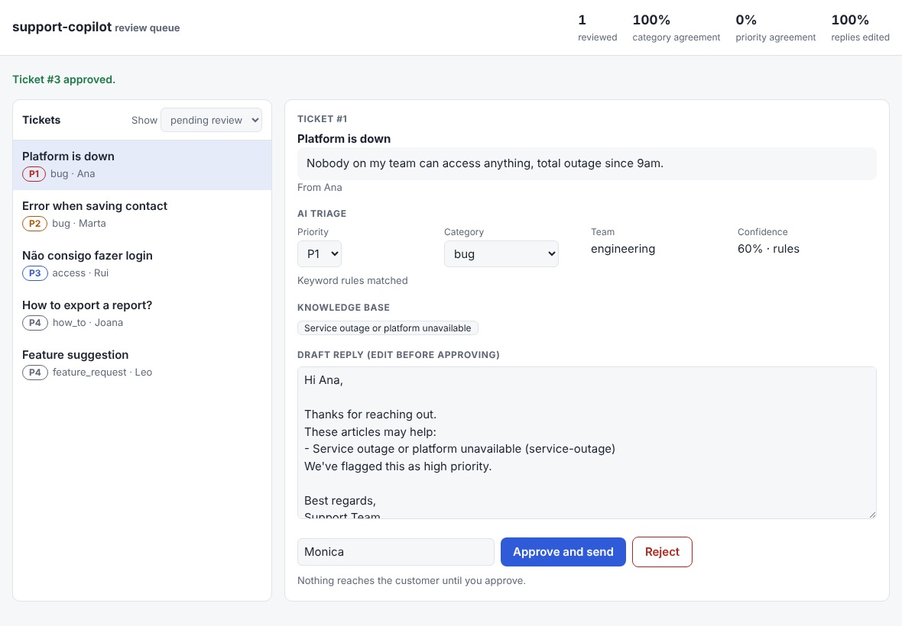
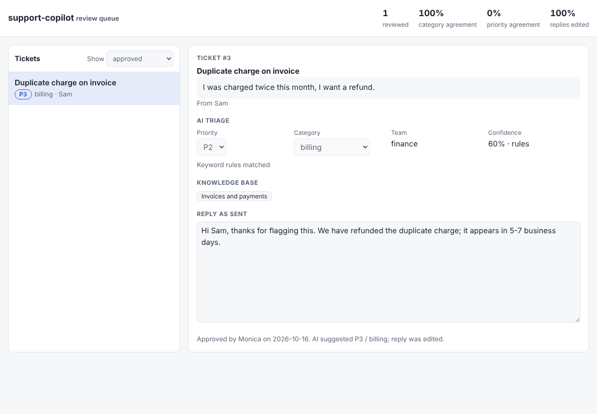

# support-copilot
[](https://github.com/monicaslgc/support-copilot/actions/workflows/tests.yml)

A human-in-the-loop AI copilot for support tickets. It triages incoming tickets (category, P1-P4 priority, owning team), finds relevant knowledge-base articles (RAG) and drafts a reply. **Nothing reaches the customer until a human approves it.**

It plugs into ticket systems through a small adapter interface. Two adapters ship today: **Zammad** and **Zendesk**.

> **Status: concept / portfolio project**, built from scratch with synthetic data. Both adapters follow the vendors' documented API and webhook shapes, but have only been tested against stateful fakes of those APIs, **not against a live Zendesk or Zammad instance**. Without credentials they run in dry-run mode.

## What it looks like

A review queue sorted by urgency. The reviewer sees the customer's message, the AI's triage (priority and category can be overridden), the knowledge-base articles it used and an editable draft reply. Nothing is sent until someone approves.


After a decision the queue updates and the metrics show how often humans agree with the AI. Here the reviewer rewrote the reply and raised the priority, so priority agreement is 0%.



Reviewed tickets show the reply that was actually approved, not the AI's original draft. The page also works on a phone and in dark mode.

| Approved ticket | Mobile, dark mode |
|---|---|
|  |  |

## Why human-in-the-loop

The companion project, [agent-triage-kit](https://github.com/monicaslgc/agent-triage-kit), explores the opposite end: agents that resolve tickets on their own once confidence clears a threshold. This project explores the other side of the same question: when the AI should only suggest, and how you measure whether it has earned more autonomy.

Every review stores what the AI proposed next to what the human decided. `/metrics` turns that into the numbers that justify automating more (for example, auto-approving P4 tickets once agreement is consistently high).

```
ticket -> classify (LLM or rules) -> RAG over KB -> draft reply -> review queue -> human decides -> metrics
```

## Run it

```bash
pip install -r requirements.txt
uvicorn app.main:app --reload     # review UI at http://127.0.0.1:8000/  ·  API docs at /docs
python scripts/seed_demo.py       # load the sample tickets so there is something to review
pytest
```

### Claude or rules

Without credentials the app classifies with keyword rules (offline, deterministic). With `ANTHROPIC_API_KEY` (or `ANTHROPIC_AUTH_TOKEN`) it uses Claude to classify tickets and draft replies from the matching KB articles.

- Model: `claude-opus-5-5` by default. Set `TRIAGE_MODEL` to change it, for example `claude-haiku-5-5` for cheaper bulk triage. Requests use low effort, a 20 s timeout and one retry, so a slow model call cannot hang a webhook.
- The ticket text is fenced in `<ticket>` tags and the system prompt tells the model to treat it as data. A human still reviews every reply before it is sent.
- If the model refuses, is cut off, answers with something that is not valid JSON, or the API is down, the ticket is still triaged: the app falls back to the rules, logs why, and says so in the triage rationale (`LLM unavailable (...)`) and `source: "rules"`.
- The Claude path is tested against a fake SDK, not against the live API.

## API

| Method | Route | Purpose |
|---|---|---|
| GET | `/` | The review queue page (no data of its own: it calls the API below) |
| POST | `/tickets` | Triage a ticket and draft a reply (stays `pending_review`) |
| GET | `/tickets?status=` | Review queue, most urgent first. Reviewed tickets include a `review` with the human's decision and the reply that was sent |
| GET | `/clusters` | Groups of tickets about the same issue that still have something to review, possible incidents first |
| POST | `/clusters/{id}/review` | One decision for every pending ticket of a possible incident (409 for other groups) |
| POST | `/tickets/{id}/review` | Human approves or rejects; can correct priority, category and reply |
| POST | `/webhooks/{system}` | Inbound webhook from a ticket system (`zammad`, `zendesk`) |
| GET | `/outbox` | Audit log of calls to ticket systems (`sent`, `dry_run`, `error`) |
| GET | `/metrics` | Human vs AI agreement and reply edit rate |
| GET | `/health` | Liveness, whether the LLM is enabled, which ticket systems are configured |

Set `API_KEY` and send it as `X-API-Key` to protect everything except `/health` and the webhooks (which use each system's own signature). If `API_KEY` is not set the API is open, which is only fine on a local machine.

## Duplicates and incident spikes

When an outage starts, the queue fills with near-identical tickets. Reviewing them one by one is slow, and each reviewer answers the same thing. So tickets are linked as they arrive, with rules a reviewer can read:

- **Same issue:** within a time window (60 min by default), tickets with the same best-matching knowledge-base article **and** the same category, or with near-identical text, share a cluster.
- **Possible incident:** a cluster with tickets from 3 or more different customers (`SPIKE_MIN_CUSTOMERS`). The queue shows a banner, the tickets carry an `incident ×N` badge, and one click approves them all. Without edits each customer gets their own draft; with an edit the same text goes to everyone. Each ticket is still recorded as its own review.
- **Possible duplicate:** the same customer opening another ticket of the same category in the window. It is only a flag, since a person decides whether it really is a duplicate.
- The internal note in Zammad or Zendesk says why (`POSSIBLE INCIDENT: 4 tickets from 4 customers about ...`, `Possible duplicate of ...`) and adds the tags `ai_spike` and `ai_possible_duplicate`, so agents who never open this tool still see it. A ticket is tagged when it arrives, so the first reports of an incident are not tagged retroactively.


Limits: matching is lexical (same words, same article), not semantic. Linking can chain: A joins B and B joins C even if A and C are far apart in time. Bulk reviews count each ticket in `/metrics`, so a large incident weighs heavily on the agreement numbers. Nothing raises a ticket's priority automatically. It only warns.

## Ticket system integrations

```
ticket created -> webhook -> /webhooks/{system}
  -> AI triage -> INTERNAL note + priority + tags on the ticket
  -> agent reviews -> approved: PUBLIC reply
                      rejected: internal note + tag ai_rejected
```

Guarantees, enforced by the same end-to-end tests for every system:
- The customer never sees the AI suggestion, only the reply a human approved.
- Tags are added, never replaced, so the ones an agent already set survive.
- Webhooks are idempotent per `(system, ticket id)`, since ticket systems retry failed deliveries. Two systems can use the same ticket id without colliding.
- If the ticket system is unreachable, the triage and the human's decision are kept and the failure is logged in `/outbox`. There is no automatic retry yet.
- Dry-run records the exact requests that would be sent.

| | Zammad | Zendesk |
|---|---|---|
| Auth | `Authorization: Token token=...` | Basic `email/token:api_token` |
| Webhook signature | `X-Hub-Signature: sha1=<HMAC-SHA1>` | `X-Zendesk-Webhook-Signature` (HMAC-SHA256 of timestamp + body) |
| Priority | P1, P2 -> high; P3 -> normal; P4 -> low (no "urgent" by default; P1 vs P2 stays in the tags) | urgent / high / normal / low |
| Internal vs public | `ticket_articles` with `internal: true/false` | comment `public: false/true` |
| Tags | `POST /tags/add` (additive) | `additional_tags` (additive; `tags` would overwrite) |

Environment variables:
- Zammad: `ZAMMAD_URL`, `ZAMMAD_TOKEN`, `ZAMMAD_WEBHOOK_SECRET`
- Zendesk: `ZENDESK_SUBDOMAIN`, `ZENDESK_EMAIL`, `ZENDESK_API_TOKEN`, `ZENDESK_WEBHOOK_SECRET`
- Core: `ANTHROPIC_API_KEY`, `TRIAGE_MODEL`, `TRIAGE_DB`, `API_KEY`
- Clustering: `CLUSTER_WINDOW_MIN` (default 60), `SPIKE_MIN_CUSTOMERS` (default 3)

Always set the webhook secret in production; without it the webhook endpoint accepts any caller.

### Connecting Zammad
Zammad is open source and self-hostable (see [zammad-docker-compose](https://github.com/zammad/zammad-docker-compose)).
1. Create an API token (Profile > Token Access) with `ticket.agent` permission and set `ZAMMAD_URL` and `ZAMMAD_TOKEN`.
2. Admin > Webhook: endpoint `https://<your-host>/webhooks/zammad`, optionally an HMAC SHA1 signature token matching `ZAMMAD_WEBHOOK_SECRET`. The adapter reads Zammad's default payload (`{"ticket": {...}, "article": {...}}`).
3. Admin > Trigger: "ticket created" -> notify webhook. Use *created*, not *updated*, so the adapter's own notes don't loop back.

The Zammad payload and API calls are based on its documentation and should be verified against your instance and version before relying on them.

### Connecting Zendesk
1. Webhook body: `{"ticket_id":"{{ticket.id}}","subject":"{{ticket.title}}","description":"{{ticket.description}}","requester":"{{ticket.requester.name}}"}`, endpoint `https://<your-host>/webhooks/zendesk`, signing secret as `ZENDESK_WEBHOOK_SECRET`.
2. Trigger on "ticket created" -> notify the webhook. Create an API token under Apps and integrations > APIs.

### Adding another system
Implement `TicketSystem` (`app/ticketsystems/base.py`): `verify_webhook`, `parse_webhook`, `post_internal_note`, `post_public_reply`, `post_rejection`, plus `base_url`/auth. Register it in `build_systems()`. Add a stateful fake to `tests/fakes.py` with the same read API (`public`, `internal`, `tags`, `priority`) and add it to the `env` fixture params: the whole end-to-end suite then runs against it.

## Tests

109 tests, run on Python 3.11 and 3.12 in CI together with `ruff`. The review page was also driven in a real browser (Chromium) to check the approve and reject flows, the mobile layout and that a hostile ticket (`<script>`, ``) is shown as text and never executed; that browser run is a manual check, not part of CI.

- **End to end, for every ticket system:** the same scenarios run against stateful fakes of the Zammad and Zendesk APIs that apply each system's update semantics (additive tags, public vs internal), and assert the final state of the ticket, not just the requests sent.
- **The Claude path:** a fake SDK checks the request shape (model, low effort, enough `max_tokens` for thinking, timeout, fenced ticket text, no removed parameters) and every kind of unusable reply (refusal, truncation, thinking block first, not JSON, unknown category, missing keys, API error).
- **Concurrency:** 8 threads reviewing the same ticket (exactly one wins, the customer gets one reply), 8 identical webhooks (one ticket, one note, no 500s), and a deterministic version of the same race.
- **Security and limits:** API key on every protected route, webhook signatures, oversized webhooks, review actions that are not approved/rejected.

I checked that the tests catch real bugs by breaking the code on purpose, 20+ ways (public/internal swapped, tags overwritten, wrong priority map, wrong signature algorithm, missing idempotency, ids colliding across systems, non-atomic review, unlocked database reads, reading `content[0]` instead of the text block, the old `max_tokens`, a 10 minute timeout, unhandled refusals, no API key check, no size limit): each break made at least one test fail.

## Known limitations

- Not verified against live Zammad or Zendesk instances (see status above).
- Retrieval is TF-IDF over six sample articles, with plural folding and a cutoff relative to the best match. It is lexical: it does not understand synonyms, so a differently worded question can miss the right article. Embeddings (for example pgvector) are the next step.
- Rule-based classification is a baseline, not a production classifier.
- No automatic retry for failed ticket-system calls; no check on webhook timestamp age.
- A multi-request update (for example Zammad's priority + note + tags) is not transactional: if one call fails midway, the earlier ones stay applied.
- A single SQLite connection behind a lock: fine for one instance, not for several. Use PostgreSQL to scale out.
- The API key is one shared secret, not per-user auth, so reviews are attributed to whatever `reviewer` string the caller sends.

## Next steps

- Run the Zammad adapter against a real self-hosted instance and fix whatever differs from the docs
- Embeddings with pgvector and PostgreSQL instead of TF-IDF and SQLite
- Retry of failed `/outbox` entries
- A small review-queue UI
- A labelled evaluation set to compare rules against the LLM
