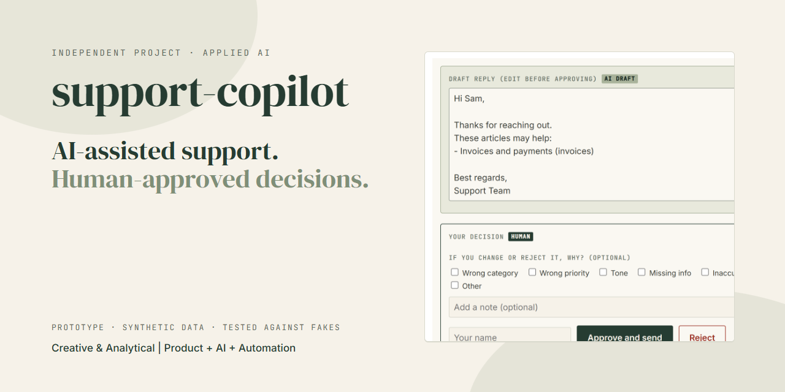
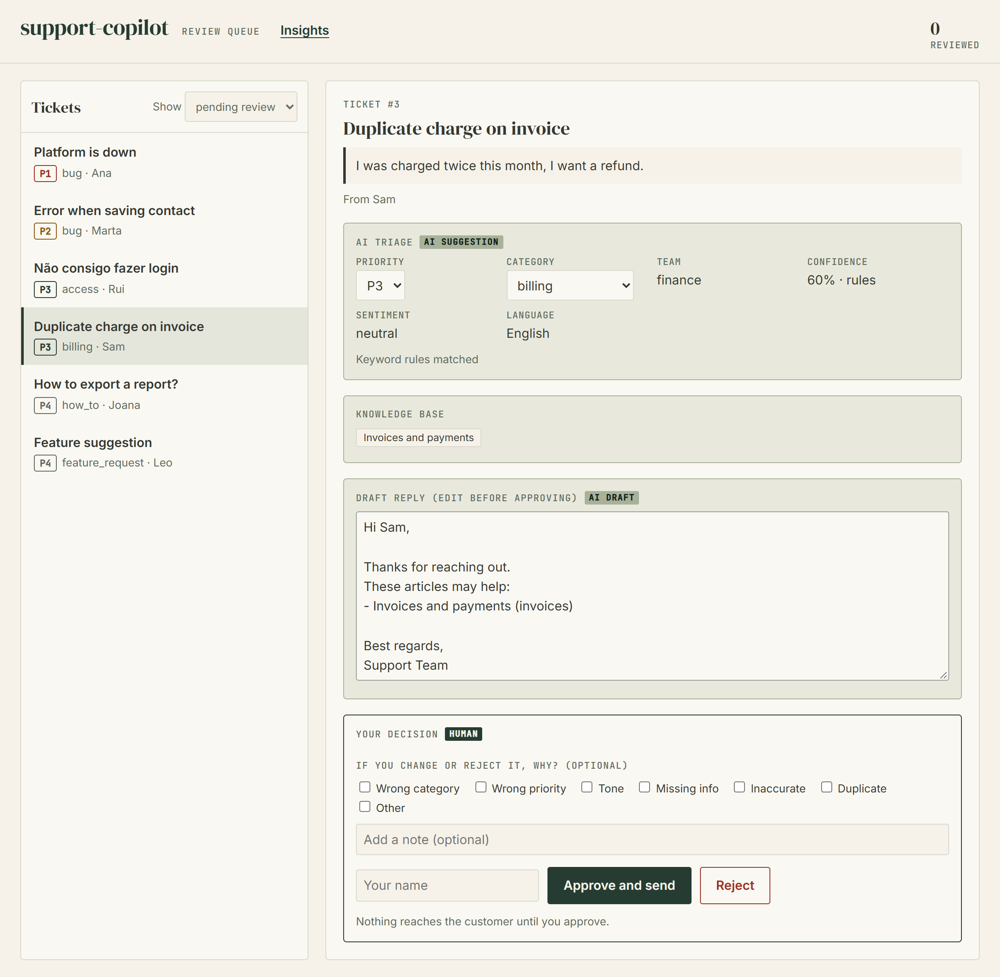
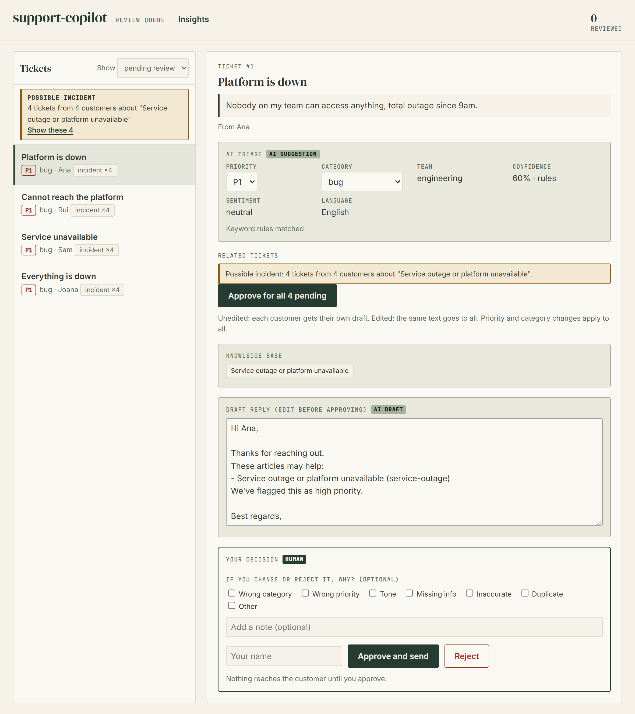
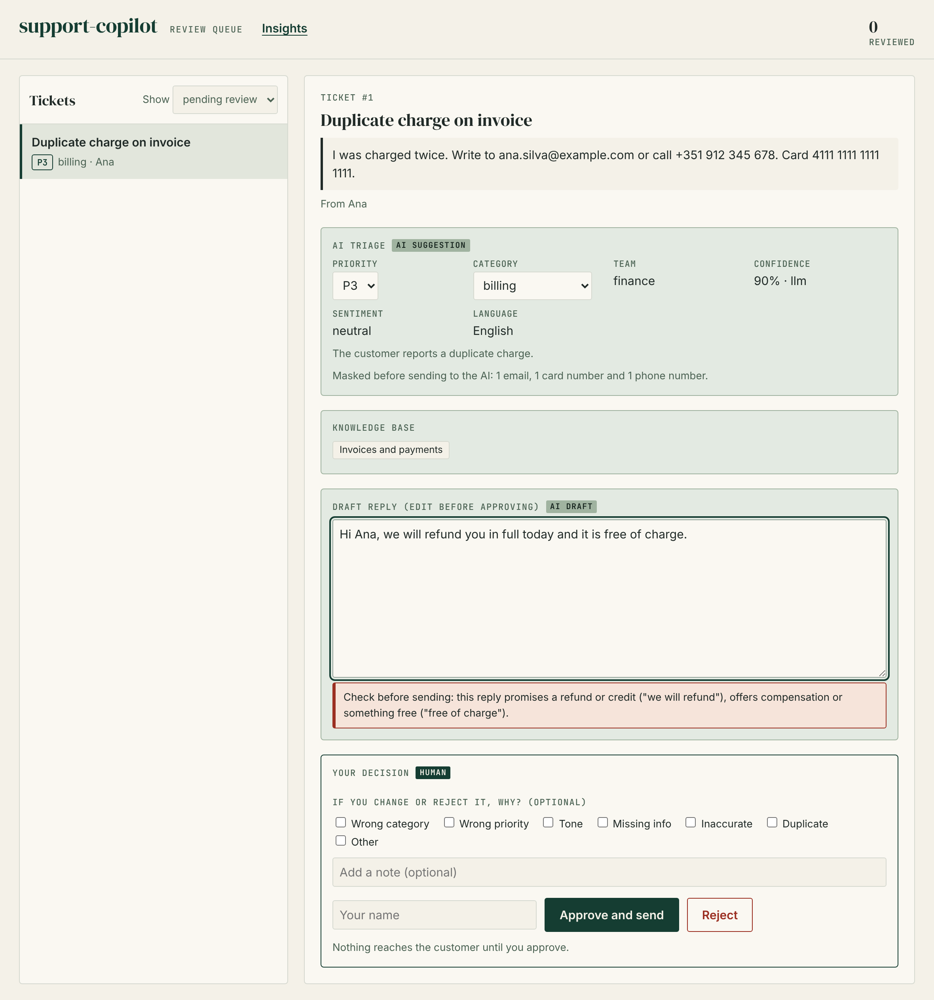
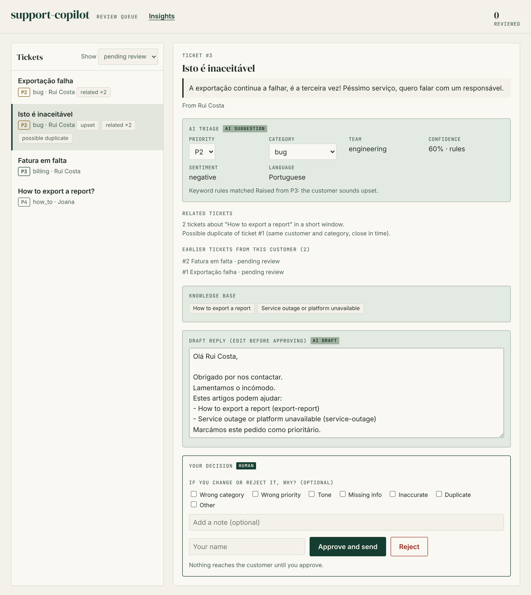
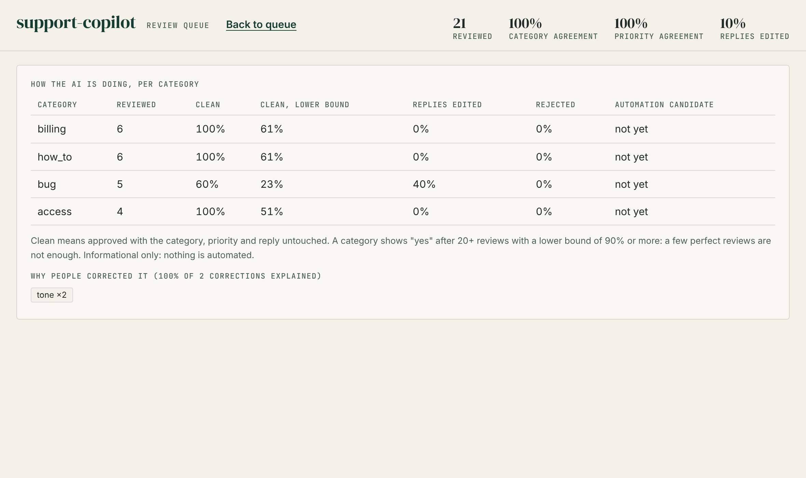
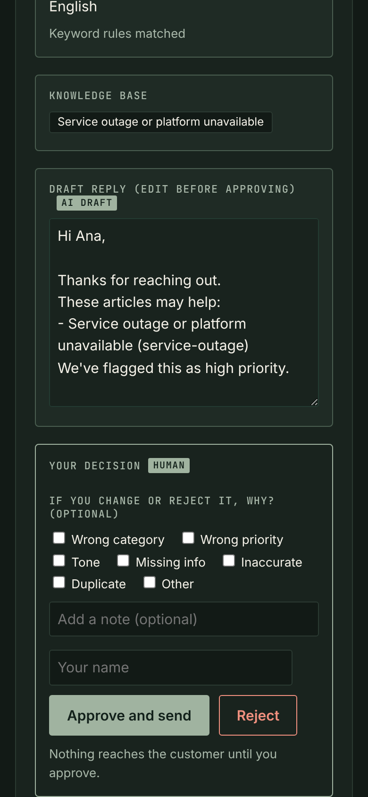

# support-copilot

[](https://github.com/monicaslgc/support-copilot/actions/workflows/tests.yml)   



**An add-on for the support setup you already have, not another app to adopt.** It listens to your helpdesk (Zendesk, Zammad or your own), triages each ticket, drafts a reply in the customer's language from your help articles, and writes the result back as an internal note and tags your own triggers can route on. **A person approves every message before it reaches the customer**, by tagging the ticket in the helpdesk they already use, and the add-on measures where the AI has earned more trust. It is a Python library with an optional FastAPI router and an optional review page: bring your own ticket system, help articles, database file and tag names.

[Use it](#use-it-in-your-stack) · [See it](#see-it-in-action) · [How it works](#how-it-works) · [What is verified](#what-is-verified) · [Docs](#documentation)

> **Status: concept / portfolio project**, built from scratch with synthetic data. The Zammad and Zendesk adapters follow the vendors' documented APIs but have only been tested against stateful fakes, and the Claude calls only against a fake SDK. Nothing here has run against a live ticket system or the live API yet. See [what is not verified](docs/limitations.md).

## Why this exists

Support teams want AI help, but cannot afford an AI that sends a customer a wrong promise. And when something breaks, the queue fills with near-identical tickets that all get the same answer, one by one.

This project explores the cautious end of that question: **the AI only suggests, a person decides, and every decision is recorded**, so you can see per category whether the AI has earned more autonomy. Its companion, [agent-triage-kit](https://github.com/monicaslgc/agent-triage-kit), explores the opposite end: agents that resolve tickets on their own once their confidence clears a threshold.

## The human-in-the-loop principle

- **The AI prepares:** triage, a grounded draft, related tickets and warnings.
- **A person decides:** edits the reply, overrides the triage, approves or rejects, and can say why. Nothing is sent before that.
- **Deterministic checks sit around the model:** private data is masked before it, and promises are caught after it, with plain rules that can be read and tested.
- **Every decision is data:** per category, how often the AI was right, with a confidence bound, and why it was corrected.

## What it does

| Capability | What you get |
|---|---|
| **Triage** | Category, P1-P4 priority, owning team, sentiment and language. Claude when an API key is set, plain rules otherwise. [How](docs/features.md#how-the-ai-part-works-claude-or-rules) |
| **Grounded drafts** | Finds the matching knowledge-base article and drafts a reply in the customer's language, with an apology if they are upset. |
| **Decide in your helpdesk** | The note on the ticket says: add `ai_approve` to send the drafted reply, `ai_reject` to answer yourself. The decision is attributed to the agent. [Setup](docs/integrations.md#deciding-from-inside-the-helpdesk) |
| **Review page** (optional) | Sorted by urgency. Edit the reply, override the triage, approve or reject, answer an incident in one click. The reply that was actually sent is kept. [The page](docs/features.md#the-review-page) |
| **Incidents and duplicates** | Groups tickets about the same issue. Several customers become a possible incident, answered with one click. [Details](docs/features.md#duplicates-and-incident-spikes) |
| **Customer context** | Earlier tickets from the same customer; an upset customer moves a routine ticket up a level. [Details](docs/features.md#sentiment-language-and-customer-context) |
| **Feedback loop** | Records why a reviewer corrected the AI, and reports per category how often it was right. [Details](docs/features.md#feedback-why-people-correct-the-ai-and-where-it-has-earned-more-autonomy) |
| **Guardrails** | Masks emails, cards, IBANs, phones and passwords before the model sees them, and flags refund or deadline promises in drafts. [Details](docs/features.md#guardrails-around-the-model) |
| **Your names and tags** | Every tag, category name and team name it writes is yours to set, so your triggers and views route on them. [Taxonomy](docs/embedding.md#your-tags-names-and-who-may-decide) |
| **Ticket systems** | Zammad and Zendesk behind one interface: the AI's notes stay internal, tags are added never replaced, and the public reply only goes out after approval. [Details](docs/integrations.md) |

Twelve [user stories](docs/user-stories.md) (support agents, support leads, admins and customers) spell out what each of them needs. Each one is checked by a test, and most by a scenario you can watch run.

## See it in action

<p align="center"></p>
<p align="center"><em>The review page (synthetic demo data). Ticket, AI suggestion and human decision are three visibly different things.</em></p>

| An outage becomes one incident | A promise gets a warning |
|---|---|
|  |  |
| Four customers report the same problem; one click answers them all. | What was masked, and a warning on a refund promise (shown with a stub model). |

| Customer context | Where the AI has earned trust |
|---|---|
|  |  |
| Sentiment, language, earlier tickets, and a draft in the customer's language. | Per category, with a confidence bound. Synthetic demo reviews. |

 The page is responsive, supports dark mode and keyboard use, and keeps the decision panel at the end of every ticket, on a phone too. Colour is never the only signal: approved and rejected tickets carry a written status.

<br clear="right">

## How it works


1. **A ticket is created** in your helpdesk, which calls the webhook (signed, and idempotent if it is re-sent).
2. **The add-on masks, triages, drafts and checks,** and writes back an internal note and your own tags. The customer sees nothing.
3. **An agent adds `ai_approve` or `ai_reject`** to the ticket (or uses the review page), and the helpdesk calls the webhook again.
4. **The drafted reply is sent once, or nothing is,** the decision is recorded under the agent's name, and it feeds the per-category numbers.

## Responsible AI decisions

- **Masking before the model.** Emails, phones, cards (Luhn-checked), IBANs (mod-97-checked) and passwords become `[EMAIL]`, `[CARD]` and so on. The stored ticket keeps the original, since the reviewer needs it.
- **Promises are caught after it.** A model-written draft with a refund, guarantee or free offer is replaced by the standard reply; if a reviewer types one, the banner turns red and approval needs a second click.
- **Failure is visible and safe.** A refusal, truncation, invalid JSON or API outage falls back to the rules, and the triage says so (`source: rules`). A failed ticket-system call is logged in the outbox, not lost.
- **Known gaps, stated.** Names and postal addresses are not masked, an oddly worded promise gets through, and a reviewer can click through the warning. A person still reads every reply. [Guardrails in detail](docs/features.md#guardrails-around-the-model)

## How it is validated

- **470 tests** on Python 3.11, 3.12 and 3.13, with `ruff` and `mypy`, in CI, plus a job that builds the wheel and uses it in a clean environment. They include the same end-to-end scenarios against both ticket-system fakes, every kind of unusable model reply, races (eight reviews of one ticket, eight identical webhooks), security checks and the review page's colour tokens, contrast ratios and approval controls.
- **User stories are executable:** each of the twelve stories has an acceptance test, and a test fails if a story, its test or its demo scenario drifts apart.
- **Mutation-checked, driven in a browser, measured:** I broke the code on purpose in more than 20 ways and made sure a test failed each time (several did not at first, and each got a new test). The review page was driven in Chromium by hand, and saving a ticket takes about 3 to 4 ms and stays flat from 500 to 2000 tickets in an hour (`python scripts/benchmark.py`). [Engineering notes](docs/engineering.md).

## What is verified

| Area | State |
|---|---|
| Triage, drafts, review page, guardrails, feedback metrics | **Implemented and tested offline** (470 tests, synthetic data) |
| Library API and FastAPI router (`Copilot`, `create_router`) | **Implemented and tested offline;** CI installs the built wheel in a clean environment and runs the library example |
| Approving by tag in the helpdesk, your own tags and names | **Prototyped:** tested against stateful fakes of Zammad and Zendesk, including the webhook payloads that carry the tags and the acting agent |
| Zammad and Zendesk adapters | **Prototyped:** tested against stateful fakes only, never a live instance |
| Claude calls | **Prototyped:** tested against a fake SDK only, never the live API |
| Retrieval and rule-based fallbacks | **Baselines:** lexical retrieval and keyword rules, not production classifiers |
| Guardrails | **Rules with known gaps:** names and addresses are not masked, an oddly worded promise gets through |
| Scale and auth | One process, one SQLite file (a path or a connection you provide), one shared API key. A few thousand tickets an hour at most |

Full list and next steps: [limitations](docs/limitations.md).

## Use it in your stack

Not on PyPI yet: install from GitHub. Python 3.11 or newer; no API key and no account are needed to try it.

```bash
pip install "support-copilot[fastapi] @ git+https://github.com/monicaslgc/support-copilot"   # add [claude] for model-backed triage
```

| You want | You use |
|---|---|
| To try it on your own tickets and connect your helpdesk | The [step-by-step guide](docs/getting-started.md): an offline run on your export, `python -m support_copilot.doctor`, then dry-run, shadow and pilot stages |
| Triage and a draft inside your own code | `Copilot().suggest(ticket)`: nothing is stored or sent. [`examples/library_usage.py`](examples/library_usage.py) |
| The queue and webhooks in your FastAPI app | `app.include_router(create_router(Copilot(db=..., kb=...)))`. [`examples/embed_fastapi.py`](examples/embed_fastapi.py) |
| Your tags, names and who may approve | `Copilot(taxonomy=Taxonomy(...), allowed_reviewers={...})`. [How](docs/embedding.md#your-tags-names-and-who-may-decide) |
| Another ticket system | Implement `TicketSystem` and pass `Copilot(systems={...})`. [How](docs/integrations.md) |

The core has no web-framework dependency. The [embedding guide](docs/embedding.md) covers your own help articles, database, API key and ticket systems.

## Try it with the reference server

```bash
git clone https://github.com/monicaslgc/support-copilot && cd support-copilot
pip install -e ".[dev]"   # or: make install
uvicorn support_copilot.main:app --reload          # review page at http://127.0.0.1:8000/
python scripts/seed_demo.py            # in another terminal: loads sample tickets
python scripts/demo.py all             # plays the user stories against the server and checks each outcome
pytest                                 # 470 tests, offline
```

`scripts/demo.py list` shows the scenarios. [`examples/`](examples/README.md) has ready-made Zammad and Zendesk payloads and the `curl` commands to send them, including signed ones and the approve-by-tag update. To use Claude, set `ANTHROPIC_API_KEY` (the model is `TRIAGE_MODEL`). To connect Zammad or Zendesk, see [integrations](docs/integrations.md). Every setting is in [API and configuration](docs/api.md).

## Documentation

**Run it**
- [Run it against your environment](docs/getting-started.md): install, configure, check, connect, verify, troubleshoot
- [Ticket system integrations](docs/integrations.md): Zammad, Zendesk, approving by tag, adding another system
- [Embedding guide](docs/embedding.md): your own articles, database, API key, tags and ticket systems
- [API and configuration](docs/api.md): every route and every environment variable
- [Examples](examples/README.md): payloads and `curl` commands for Zammad and Zendesk, and the sample tickets

**Understand it**
- [Features in detail](docs/features.md): the review page, Claude or rules, incidents, customer context, feedback, guardrails
- [User stories](docs/user-stories.md): who needs what, with acceptance criteria, each checked by a test
- [Engineering notes](docs/engineering.md): tests and performance

**Know its limits**
- [Limitations and next steps](docs/limitations.md), and [SECURITY](SECURITY.md) before connecting real customer data

## Built with

Python, FastAPI, Pydantic, SQLite and the Anthropic SDK. The review page is plain HTML and JavaScript with no framework, and never inserts ticket text as HTML. MIT licensed. By [Monica](https://github.com/monicaslgc).
